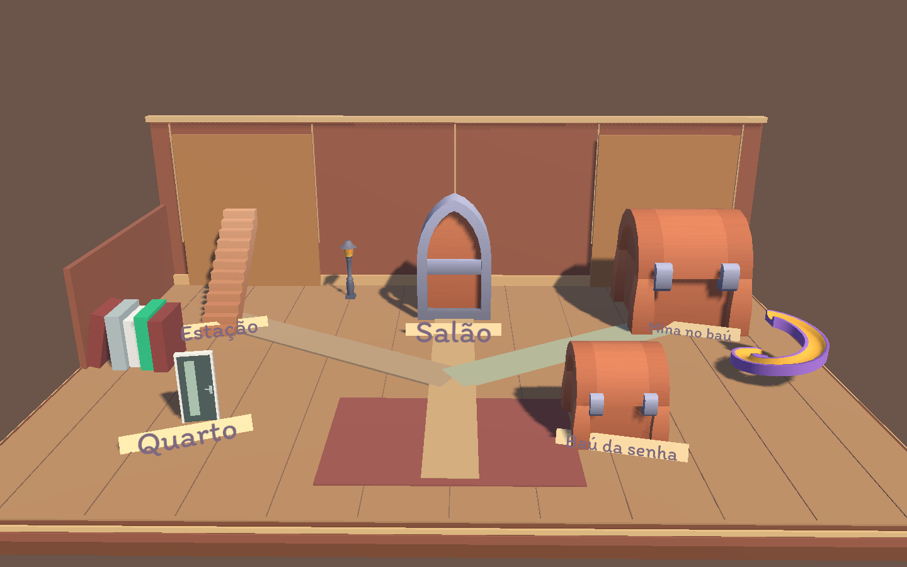
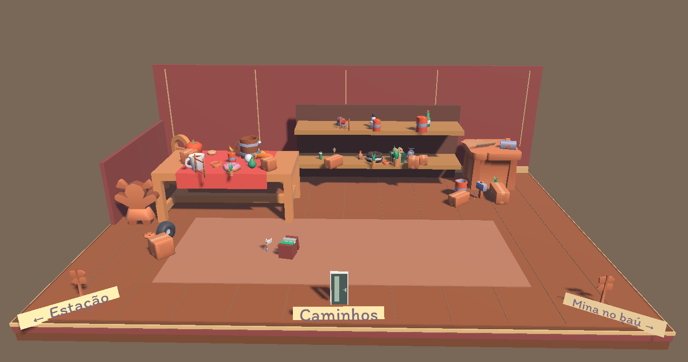

# Bem-Te-Vi

Um quarto de criança contém três mundos de brinquedos: **Faroeste de Quintal**, **Missão Caixa Lunar** e **Liga dos Brinquedos**. Explore maquetes, encontre objetos nas charadas e brinque com mecanismos. Versão **0.15.0**, para Windows x64, Unity **6000.6.4f1**, URP 17.6.0 e Input System 1.20.1.

## Nesta revisão

- As 202 divergências de hashes foram corrigidas restaurando os bytes originais. Os 445 arquivos passam na auditoria, sem troca de hashes esperados.
- As 27 charadas foram reescritas e os 162 alvos redistribuídos em nichos, grupos e sobreposições. A conferência estima 133 alvos parcialmente encobertos, mantendo todos clicáveis e reconhecíveis.

- Três salas de transição baseadas na referência local de I Spy Fantasy, com caminhos e placas para as três buscas, o desafio e o quarto. Todas as salas têm retorno direto ao mapa. Nenhuma passagem exige uma peça.
- Nove buscas em ambientes contínuos de 18,8 × 13 unidades: estação sobre livro, salão de bonecas, baú aberto, base com bancada, jardim fantástico, garagem em caixa, praça, rio de fita e armário. Cada composição tem câmera própria.
- Dificuldade crescente: 12, 15 e 18 objetos extras por sala nos três mundos, além das três rodadas existentes. Os 162 IDs e os cadernos existentes são preservados.
- Modelos leves de Pirate Kit e Castle Kit (Kenney/CC0), somando cerca de 254 KB com materiais, atlas e licenças. Os modelos leves de Marble Kit da revisão anterior continuam disponíveis.
- Três mundos, três rodadas por mundo, 27 charadas e 162 descobertas. Cada sala contém 18 alvos possíveis; seis participam de cada rodada. Os objetos extras continuam compondo o cenário.
- Itens encontrados fazem uma pequena animação e voltam exatamente ao lugar. Permanecem visíveis ao revisitar a sala, mudar de rodada e carregar o jogo; um segundo clique não pontua novamente.
- Sem botão de dicas, destaque revelador, coleta assistida ou mensagens de “Achei!”. A confirmação vem da voz; o verso correspondente muda de cor.
- Exploração livre pelas placas, caminhos e botão **Mapa**, inclusive com buscas incompletas. Brinquedos reagem a cliques sem depender de itens encontrados.
- Buscas em ambientes amplos e dentro de um baú; finais com combinação num baú, memória espalhada pelo cenário e associação num comunicador de brinquedo.
- Bases em camadas, acabamento de madeira e painéis de cartão. Câmeras fixas enquadram o conteúdo e suas bordas. As entradas do quarto formam um grupo compacto entre o chão e a mesa, como na organização da referência.
- Perfis por nome, salvamento automático, retorno à última sala, backup e recuperação. Descobertas, rodadas, mecanismos, números do baú e associações ficam no caderno de cada jogador.

## Abrir e jogar

1. Abra a pasta do projeto no Unity Hub usando **6000.6.4f1** e aguarde a importação.
2. Abra `Assets/BemTeVi/Scenes/Main.unity`.
3. Execute **Bem-Te-Vi → 1. Preparar projeto** e **2. Verificar conteudo**. A revisão 15 recompõe cenas antigas usando o catálogo; preserve composições manuais antes de atualizar.
4. Dê Play. Clique em **Iniciar**, crie um jogador ou escolha um nome para continuar.
5. Clique nas miniaturas do quarto e nas passagens dos cenários. **Menu** reúne pausa, leitura, caderno, opções e troca de jogador.

As 18 cenas estão registradas. As hierarquias antigas são substituídas por conteúdo da revisão 15 na preparação; o runtime também monta o catálogo quando necessário. IDs dos objetos existentes e GUIDs dos assets foram preservados.

## Voz

A descoberta toca primeiro uma gravação específica em `NarrationBank`. Quando ela não existe, o Windows lê uma confirmação com sua voz instalada, preferindo português brasileiro. As falas entram em fila; sair da sala, pausar ou perder o foco interrompe a voz. Volumes de voz e efeitos são independentes.

Não há gravações humanas incluídas: existem **27 campos de charadas e 162 campos de confirmação**, prontos para recebê-las. O fallback usa Windows PowerShell e System.Speech, sem internet e sem gerar arquivos de áudio; depende desses componentes e das vozes instaladas. Fora do Windows, use gravações. Veja [NARRACAO.md](Docs/NARRACAO.md) e [NARRACAO_DESCOBERTAS.md](Docs/NARRACAO_DESCOBERTAS.md).

## Salvamento

Escolha seu nome para retomar a última sala. O jogo salva a cada descoberta, passagem, interação de puzzle e troca de jogador, além de pausa do aplicativo e saída. Criar outro jogador mantém os cadernos existentes. Reiniciar um mundo afeta apenas o jogador atual e aquele mundo.

Os dados ficam em `Application.persistentDataPath/Saves/players.json`: no Windows, normalmente `%USERPROFILE%/AppData/LocalLow/BemTeVi/Bem-Te-Vi/Saves/`. Uma cópia anterior válida fica em `players.json.bak`. A escrita usa arquivo temporário, checksum e substituição atômica. Saves antigos legíveis são migrados; a revisão antiga que apagava o save ao iniciar não permite recuperar dados que já foram excluídos. [Detalhes](Docs/SALVAMENTO.md).

## Assets e tamanho

Foram selecionados 19 modelos adicionais de [Holiday Kit](https://kenney.nl/assets/holiday-kit), [Train Kit](https://kenney.nl/assets/train-kit) e [Brick Kit](https://kenney.nl/assets/brick-kit), de Kenney/CC0: trenzinhos, vagões, blocos, presentes, soldadinhos e outros brinquedos. Seus OBJ somam **886.068 bytes**. Não foi incluído o pacote inteiro. O conjunto de modelos, materiais de origem e texturas ocupa aproximadamente **6,2 MB**, antes dos arquivos de importação do Unity.

Os modelos existentes de Kenney, o pato de Plat251/Poly Haven, as fontes e os efeitos continuam incluídos. A seleção existente inclui modelos de [Pirate Kit](https://kenney.nl/assets/pirate-kit) e [Castle Kit](https://kenney.nl/assets/castle-kit). Fontes, hashes e licenças ficam em `Docs/asset-manifest.json` e `Assets/ThirdPartyLicenses`. Nenhum conteúdo do vídeo foi extraído para os assets do jogo.

## Estado da validação

**657 verificações C# de domínio e persistência passaram**, incluindo circulação com o caderno vazio, remoção de flags de passagens antigas, rodadas, isolamento de jogadores, migração, salvamento, retomada de sala/puzzle, corrupção e recuperação.

O projeto foi importado e compilado no **Unity 6000.6.4f1**. As 18 cenas foram reconstruídas e a validação do editor passou. Uma conferência por câmera e raycast confirmou os **162 alvos e 54 passagens visíveis e clicáveis**. As novas [prévias de composição](Docs/Previews/v15) são renderizações do próprio Unity, sem a interface de jogo. Voz e experiência de uma partida completa ainda precisam de conferência manual. Não foi gerado executável Windows nesta revisão.

**19 testes EditMode passaram**, incluindo permanência e clique dos objetos após descoberta/reentrada, materiais, navegação sem peças e migração de saves antigos.

O validador Python passa em todas as verificações, incluindo os **445 hashes**. Os 202 arquivos divergentes tiveram suas terminações de linha originais restauradas; o manifesto foi preservado. O [recibo de integridade](Docs/ASSET_INTEGRITY_V15.json) registra cada reparo. Veja [Atualização 0.15](Docs/ATUALIZACAO_V15.md).

## Build e verificações

- No Unity, selecione Windows x64 e execute **Bem-Te-Vi → 3. Compilar Windows**. A saída é `Builds/Windows/BemTeVi.exe`; distribua toda a pasta.
- Conteúdo: `python Tools/validate_content.py`.
- Domínio: `dotnet run --project Tools/DomainChecks -- Assets/Resources/BemTeVi/catalog.json` (.NET 8).
- Testes Unity: Test Runner → EditMode; roteiro completo em [VALIDACAO.md](Docs/VALIDACAO.md).

Leia também [GDD](Docs/GDD.md), [Cenas](Docs/CENAS.md) e [Atualização 0.15](Docs/ATUALIZACAO_V15.md).
